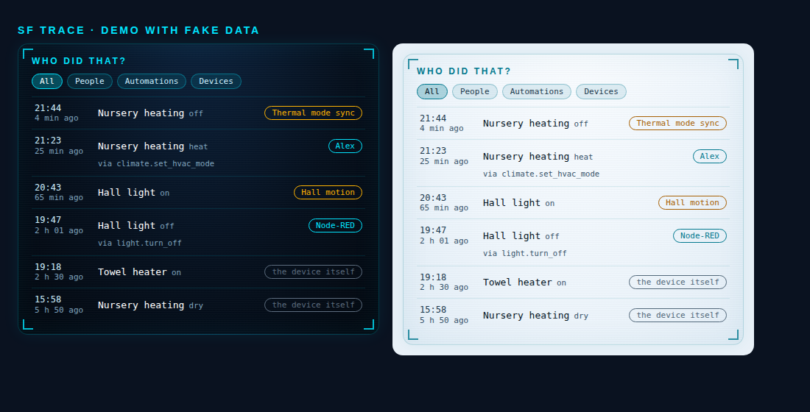

# SF Trace

**Who (or what) just changed that?** A Lovelace card that answers the question every Home Assistant owner asks at least once a week: *"why did this turn off?"* It reads the logbook and tells you, for each change, whether it was **a person, an automation, a service call, another entity, or the device itself**.

[](https://hacs.xyz)
[](LICENSE)
[](https://my.home-assistant.io/redirect/hacs_repository/?owner=khrom06&repository=SF-Trace&category=dashboard)

<p align="center"></p>

Same HUD look as [SF Cards](https://github.com/khrom06/SF-Cards): the cards sit side by side on one dashboard.

> **Why this exists.** Home Assistant has long had a feature request for a "who changed this switch" sensor. The information is already there: every state change carries a *context* (user id, automation, service, triggering entity). SF Trace just reads it and shows it where you look.

## Install

1. HACS → ⋮ → *Custom repositories* → add `https://github.com/khrom06/SF-Trace`, category **Dashboard**; install.
2. Reload the browser (HACS registers the resource for you).

## Configuration

```yaml
type: custom:sf-trace-card
title: Who did that?            # optional
entities:                       # what to trace (or use `entity:` for a single one)
  - climate.nursery
  - light.hall
  - switch.towel_heater
hours: 24                       # how far back to read the logbook (1–168)
limit: 12                       # rows shown (1–50)
theme: auto                     # auto | dark | light
```

Each row shows the time, the entity, the new state, and a coloured chip:

| Chip | Meaning |
|---|---|
| **cyan** — a name | A person (or an integration user) called a service: `via light.turn_off` |
| **amber** — an automation / script name | An automation or script did it (even when you started it, the automation wins) |
| **amber** — an entity name | The change was caused by another entity's state change |
| **violet** — `domain.service` | A service call with no user attached |
| **grey** — *the device itself* | Nothing in Home Assistant asked for it: a physical switch, a thermostat's own logic, a sensor report |

Filter buttons narrow the list to *People*, *Automations* or *Devices*. Tap a row for the usual more-info dialog.

**Names.** People are resolved from `person.*` entities. For other users (Node-RED, the Supervisor, add-ons…) the card also tries the admin-only user list; if you are not an administrator those show as "someone".

Languages: en, fr, de, es (follows the Home Assistant language).

## Safe by design

* One logbook query on load, then **at most one every 15 s**, and only after a watched entity actually changed. A busy instance cannot turn it into a query storm (tested: 100 state changes → 0 extra queries inside the window).
* It never writes anything and never calls a service.
* Names and states coming from Home Assistant are HTML-escaped.

## Tests

```bash
./test/run.sh   # build check + 34 render checks in headless Chrome, including a real logbook entry shape
```

---

> **Made by Claude.** Designed and written by Claude (Anthropic's AI) working with its human partner. MIT licensed.
